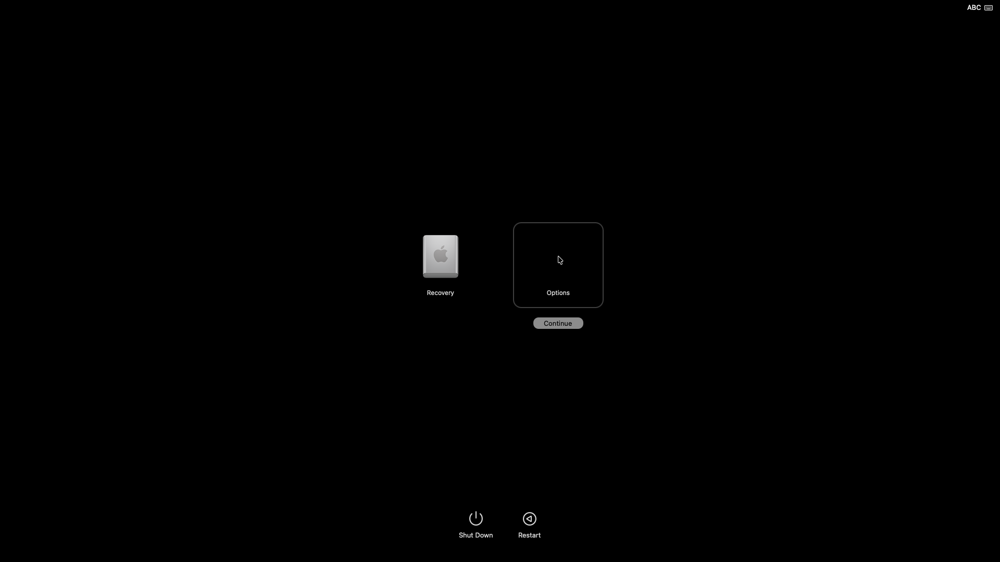

# ARM Hackintosh / MacVM

在 **x86_64 Linux** 上，通过 **QEMU `qemu-system-aarch64` + TCG** 运行 ARM64 macOS 的实验工程。
不是 `qemu-arm`（ARM32 用户态模拟），也不是直接使用 KVM 执行 ARM 指令。

## 当前真实进度（2026-09-02）

- macOS 26.6 / 25G72：已启动 ARM64 XNU、RecoveryOS、WindowServer，并显示启动选项界面。
- Boot115：点击 Options / Continue 后开始启动 Language Chooser，但 Linux Vulkan 渲染器崩溃。
- 已用独立用例复现 Vulkan render-pass / framebuffer 附件数量不一致，并修复 MRT、framebuffer-fetch、depth 组合及资源释放。
- Boot116：新构建正在原隔离 VM 中验证。**尚未证明进入 macOS 安装界面，更未完成安装。**
- 当前 Vulkan 是隔离 VM 内的 Mesa lavapipe 软件实现；未测试 NVIDIA 4060 Ti，不能据此声称硬件 GPU 性能。
- 已有验证：469 个 Python 测试通过；12 个设备能力单测通过；6 个 MRT 定向回归通过且无 Vulkan validation 错误。
- 仍有已知问题：全量图形测试存在其他 SPIR-V validation 报错；Clippy 全量严格检查未通过；部分图形协议尚未实现。详见 [BLOCKERS.md](BLOCKERS.md)。

下面是真实 QMP 截图，**仅为启动选项界面，不是安装器截图**：



## 目录与备份

| 路径 | 内容 |
|---|---|
| `third_party/` | 验证 VM 实际源码快照，含本项目改动；保留各上游许可证 |
| `patches/` | 已落地的 QEMU / Reims 有序补丁 |
| `scripts/`、`tools/` | 构建、启动、诊断、镜像准备及 QMP 工具 |
| `tests/` | Python 回归测试；Rust 用例在对应第三方源码中 |
| `docs/` | 架构、环境、性能、恢复链研究及历史记录 |
| `backup/` | 备份范围、来源、构建与依赖清单、Release 制品记录 |

本开发分支是**完整源码快照型备份**，第三方源码不是仅有提交号的空子模块。
原始上游锁见 `upstreams.lock.toml`；原 `.gitmodules` 存在 `backup/original.gitmodules`。
不要对已修改的快照重复执行 apply-patches 或强制 submodule update。
备份边界、未上传的大文件及恢复注意事项见 [backup/README.md](backup/README.md)。

## 执行边界

**禁止在本机 Mac 或生产 Ubuntu 宿主机上构建、安装、调试、测试。**
一切执行仅在专用、可丢弃的 Linux x86_64 隔离 VM 内进行，不替换 `/usr` 下的 QEMU、驱动或库，
不改生产 VM、PCI/USB 穿透或服务配置。外层隔离 VM 上限 16 核 / 36 GiB；当前 ARM 客体 8 核 / 16 GiB。

仅在隔离 VM 内：

```bash
export MACVM_DEBUG_ENV_CONFIRMED=YES
./scripts/test.sh
```

`scripts/validation-boot116.sh` 是当前环境的运行记录，包含绝对路径并依赖离线恢复材料，
不是全新机器的一键安装器。`scripts/build-graphics-validation.sh` 还依赖前一构建的 `config.status`。
重建前先阅读备份清单和 `BLOCKERS.md`，在新路径准备资源，不覆盖原运行目录。

较早的 Phase 1 首页保留在 [docs/initial-phase1-readme.md](docs/initial-phase1-readme.md)，其中历史状态不能代表当前进度。
