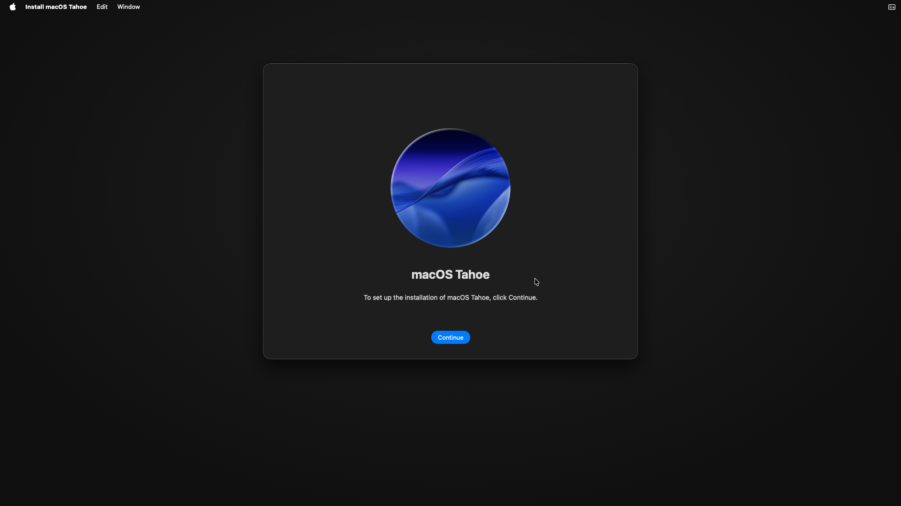

# Boot119: ARM64 macOS Tahoe installer welcome

## Result and boundary

Accepted checkpoint: **the real macOS Tahoe 26.6 / 25G72 ARM64 installer welcome
window is visibly rendered under QEMU TCG on x86_64 Linux**. Capture time is
2026-09-03 **03:09:33 +0800** (2026-09-02 19:09:33 UTC), from the screenshot's
filesystem timestamp in the isolated validation VM.



The foreground menu is `Install macOS Tahoe`; the window contains the Tahoe
artwork, `macOS Tahoe`, setup instructions and the blue `Continue` button.
The old Recovery content seen in Boot118 is absent. The image was captured by
QMP `screendump` and converted from PPM to PNG with `sips`; no content was edited.

This accepts **entry into the installer GUI**, not a completed installation.
The installer welcome Continue button has not been clicked at this checkpoint;
disk selection, installation to disk and installed-system boot remain untested.
macOS 27, NVIDIA hardware and near-native performance are not validated.

## Execution identity

- Linux execution environment: `macvm-validation`, `uname -m` = `x86_64`.
- Live QEMU PID: **925112**, start 2026-09-03 02:44:29 +0800.
- Binary: `/home/macvm/src/macvm/build/qemu-boot119-graphics-storage/qemu-system-aarch64`.
- Binary SHA-256: `bfedb312ba18bcaeed2ca67f449575295eb42c2a986308676e7ab17e809ce411`.
- QEMU version: 11.0.93; machine: `vmapple`; accelerator: `tcg,thread=multi`;
  CPU: `max`; ARM guest: **8 vCPU / 16 GiB**.
- Post-capture QMP: `running=true`, `status=running`, 8 CPUs,
  `base-memory=17179869184`, `plugged-memory=0`.
- Software Vulkan backend: Mesa lavapipe. This is not a hardware-GPU test.
- Run directory:
  `/home/macvm/runs/aux-26.6/xnu-imgsrc-reims-boot119-graphics-storage`.
- Launch configuration: `scripts/validation-boot119.sh`; guarded build:
  `scripts/build-graphics-storage-validation.sh`.

Only the dedicated Linux isolation VM executed builds/tests/guest code. The
production Mac handled source edits, evidence transfer and image conversion only.
The production Ubuntu hypervisor's QEMU, packages, VM files and passthrough
configuration were not modified by this validation. Boot119 remains running.

## Independent ARM64 and version evidence

The live serial log reports:

```text
Darwin Kernel Version 25.6.0: Sat Jul 11 15:25:45 PDT 2026; root:xnu-12377.161.13~4/RELEASE_ARM64_VMAPPLE
```

The exact read-only BaseSystem inspection tree is
`/home/macvm/analysis/basesystem-ro-inspect/root`.
Its `Install macOS Tahoe.app/Contents/MacOS/InstallAssistant` is identified by
`file` as **Mach-O 64-bit arm64 executable**, not x86_64 or an ARM32 executable.
Its `System/Library/CoreServices/SystemVersion.plist` has
`ProductVersion=26.6`, `ProductUserVisibleVersion=26.6`, `ProductBuildVersion=25G72`.

Serial sequence (September 2, UTC):

| Time | Observation |
|---|---|
| 19:00:30 | OSIESpringboard PID 261 reports `Activation state is Activated` |
| 19:02:32–33 | KeyRecoveryAssistant PID 271 successful auth; Springboard reports success (200) |
| 19:06:00 | InstallAssistant PID 312 reports build 532 |
| 19:06:24 | launchd starts osinstallersetupd PID 318 |
| 19:09:33 | Genuine QMP screenshot shows the complete installer welcome window |

No activation result or authentication success was fabricated. The Recovery
`Reinstall macOS Tahoe` entry and its Continue button were each clicked once;
the captured welcome is a new window from the real installer, not the recovery
menu reused as installer evidence.

## Evidence hashes

| Artifact | SHA-256 |
|---|---|
| QMP `screen-installer-first.ppm` | `e831540753f84cf78ac5b96f80ac29003e8073a6f1b795357915f271517c1231` |
| Converted `screen-installer-first.png` | `3890a58114191e8e44b1ca757b23962c2deb2f1a497650f86e1b8a35050facc7` |
| Exact ARM64 InstallAssistant | `6fe9f5c1b0104902af4710e10e17c7a83eb71d14b580273ae63b37441a4d59a5` |
| BaseSystem SystemVersion.plist | `e472903d072df1ba46173579b6f62c16c05f6cea41e9c71484cf495c1b6939df` |

The original PPM remains in the run directory and the local artifacts directory;
the PNG is included under `evidence/boot119/`. Serial, draw, fail, crash-watch and
trace logs remain in the isolated run directory. This record does not imply a
GitHub upload or a new remote backup.

## Build and test gates preceding this boot

All gates ran inside the dedicated Linux validation VM, against the source used
for the independent Boot119 build:

- Native Vulkan: **1318 unit + 58 graphics + 14 compute passed**; one intentionally
  ignored performance test, zero Vulkan validation errors in this gate.
- Host-window unit configuration: **1356 passed**. These overlap the native unit
  suite; they must not be summed as distinct tests.
- Translator: **1093 unit + 3 registry + 6 fallback passed**; workspace/all-target
  strict Clippy passed.
- Python: **495 passed, zero skipped**, including temporary-image formatter tests.
- New QEMU binary compiled and ran; shared-library resolution checks passed;
  previous Boot118 binary hash remained unchanged.
- Apple-target cross-check was unavailable; Reims full Clippy still has 13
  existing diagnostics. Neither is reported as passed.

Logs are under `/home/macvm/analysis/boot116-rootcause/`, using the
`boot119-graphics-final-gate.log`, `boot119-host-window-final.log`,
`boot119-translator-full.log`, `boot119-translator-clippy.log`,
`boot119-python-full-gate.log`, `boot119-feature-matrix-final.log` and
`boot119-build.log` filenames. See [BLOCKERS.md](../BLOCKERS.md) for source changes.

## Remaining defects and reproducibility limits

The welcome GUI is an end-to-end success for this run, not general rendering
conformance. Five earlier `resident_read` fence timeouts lost deferred writeback
obligations before drawing recovered. Dual-plane textures, some buffer texture
views and complete native-format primary render-target readback remain incomplete.
At the acceptance check, QEMU stdout/stderr were both empty and native crash-watch
had no crash report; typed declines and the earlier timeout records remain visible.

The launcher depends on already prepared local recovery materials and the build
script uses the earlier build's configuration. It is not a clean-machine installer.
No firmware, IPSW, macOS disk, private disassembly, or authentication material is
embedded in this report. The original operating-system payloads remain local.
